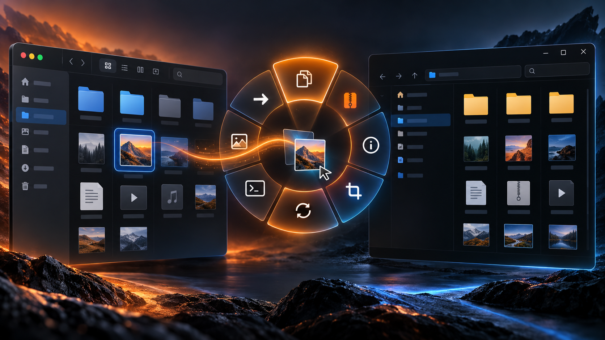

<p align="center">
  
</p>

<h1 align="center">Amberflow</h1>

<p align="center">
  <strong>Your files already know where they need to go.</strong><br>
  Drag, hold a modifier, and release onto the action you want.
</p>

<p align="center">
  <a href="https://github.com/hicham-taib/AmberFlow/actions/workflows/ci.yml"></a>
  
  
  
  
</p>

Amberflow is a native desktop utility that turns everyday file operations into one fluid gesture. Instead of opening menus, switching windows, or memorizing shortcuts, drag files from Finder or File Explorer and choose an action from a contextual radial menu.

Everything runs locally. There is no account, cloud service, analytics, or advertising.

## How it works

| 1. Drag | 2. Hold | 3. Drop |
| :---: | :---: | :---: |
| Pick up one or more files in Finder or File Explorer. | Hold **Command / Control / Shift** on macOS, or **Alt / Control / Shift** on Windows. | Release over an action. Release outside the wheel to cancel. |

The modifier selects a palette, so the wheel stays focused instead of becoming another crowded menu.

| Palette | macOS | Windows | Typical actions |
| --- | :---: | :---: | --- |
| **Tools** | Command (⌘) | Alt | Compress, metadata, crop, redact, annotate |
| **Actions** | Control (⌃) | Control | Preview, copy, move, copy path, terminal, share |
| **Convert** | Shift (⇧) | Shift | PNG, JPG, HEIC, TIFF, PDF, TXT, MD, ZIP |

## Quick start

| macOS | Windows |
| --- | --- |
| Requires macOS 14 or later. | Requires Windows 10 or 11 (x64). |
| Build the app with `./scripts/build-macos.sh`, then open `apps/macos/build/Amberflow.app`. | Open the latest successful [CI run](https://github.com/hicham-taib/AmberFlow/actions/workflows/ci.yml), download `Amberflow-Windows-x64`, extract it, and run `Amberflow.Windows.exe`. |
| To create an installer, run `cd apps/macos && ./scripts/build-dmg.sh`. | Windows may show a SmartScreen warning while preview builds are unsigned. Choose **More info → Run anyway** only if you obtained the build from this repository. |

> [!NOTE]
> The Windows edition is currently a preview. Copy, move, copy path, preview/open, terminal, and ZIP are implemented; image and PDF tools are still being brought across from macOS.

## What you get

| | Capability | Details |
| --- | --- | --- |
| ⚡ | **Fast file actions** | Common operations stay under the pointer and take one gesture. |
| 🧭 | **Contextual palettes** | Tools are grouped by intent and selected with familiar modifier keys. |
| 🔒 | **Private by design** | File names, contents, and operations stay on your computer. |
| 🛟 | **Non-destructive defaults** | Edits and conversions create new files; collisions receive numbered names. |
| 🖥️ | **Native on both platforms** | SwiftUI/AppKit on macOS and WPF/Win32 on Windows. |
| 🧪 | **Tested core behavior** | Domain rules and file-operation safeguards have automated coverage. |

## Platform status

| Platform | Stage | Stack | Current scope |
| --- | --- | --- | --- |
| **macOS 14+** | Production implementation | Swift 6, SwiftUI, AppKit, ImageIO, PDFKit, Vision | Complete action set and regression coverage |
| **Windows 10/11** | Public preview | .NET 8, WPF, Win32, Windows Shell | Native tray lifecycle, Explorer gesture monitor, radial UI, and core file actions |

## Safety first

Amberflow is designed around predictable file handling:

- Processing happens entirely on-device.
- Conversions and edits never replace source files.
- Existing destinations are preserved with collision-safe names.
- Move operations attempt rollback after a partial failure.
- Sharing requires an explicit native system handoff.
- Diagnostic output does not record file names or contents.

<details>
<summary><strong>Build and test locally</strong></summary>

### macOS

```sh
./scripts/build-macos.sh
./scripts/test-macos.sh
open apps/macos/build/Amberflow.app
```

Create the universal DMG:

```sh
cd apps/macos
./scripts/build-dmg.sh
```

The DMG is written to `apps/macos/build/Amberflow-1.7.0.dmg`. Local packages are ad hoc signed, not Developer ID signed or notarized.

### Windows

Install the [.NET 8 SDK](https://dotnet.microsoft.com/download/dotnet/8.0) and Visual Studio 2022 with the **.NET desktop development** workload, then run:

```powershell
.\scripts\build-windows.ps1
.\scripts\test-windows.ps1
dotnet run --project .\apps\windows\src\Amberflow.Windows\Amberflow.Windows.csproj
```

Create a self-contained x64 build:

```powershell
.\scripts\publish-windows.ps1 -Runtime win-x64
```

Use `win-arm64` for Windows on Arm. Published files are written under `artifacts/windows/`.

</details>

<details>
<summary><strong>Project structure</strong></summary>

```text
AmberFlow/
├── apps/
│   ├── macos/       Swift package, native app, tests, and packaging
│   └── windows/     .NET solution, WPF app, domain core, and tests
├── docs/            Product specification, architecture, and media
└── scripts/         Cross-platform build and test entry points
```

Platform integrations stay at the outer edge of the codebase, while reusable behavior lives in platform-neutral domain code.

</details>

## Documentation

- [Architecture](docs/ARCHITECTURE.md)
- [Product specification](docs/PRODUCT_SPEC.md)
- [macOS development guide](apps/macos/README.md)
- [macOS action audit](apps/macos/ACTION_AUDIT.md)
- [Windows development guide](apps/windows/README.md)

## Contributing

Contributions are welcome. New actions should document their supported inputs, collision behavior, source-preservation rules, native handoffs, and automated coverage. Keep unavailable features explicit—Amberflow should never report an action as successful when it did not run.

## License

No open-source license has been declared. All rights are reserved unless the repository owner states otherwise.

<p align="center">
  <sub>Built to keep file work fast, local, and close to your cursor.</sub>
</p>
